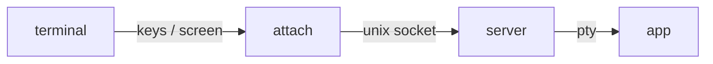

# Detachable sessions

The `detach` package keeps a program running after its terminal is gone (a dropped ssh
connection, a closed window) and lets you attach to it again from any terminal. It does what
`dtach` does, built into the app, so nothing else has to be installed on the machine.

```bash
myapp --session work      # start the session "work" and attach (or attach, if it is running)
                          # Ctrl-]  detaches; the app keeps running
myapp --attach work       # attach to a running session only
myapp --sessions          # list the running sessions
```

Quitting the app ends its session. Only one terminal is attached at a time; attaching from a
second terminal takes the session over.

## Using it in an app

Call `detach.Handle` at the top of `main`, before the app parses its own flags:

```go
func main() {
	if handled, err := detach.Handle("myapp"); handled {
		if err != nil {
			fmt.Fprintln(os.Stderr, err)
			os.Exit(1)
		}
		return
	}
	// start the app as usual
}
```

`Handle` looks for `--session`, `--attach` and `--sessions` (one or two dashes) and removes
them from the arguments the app sees. Without them it does nothing and returns `false`, so the app
runs exactly as before. The name passed to it ("myapp") only names the sockets. The demo does
this: `go run ./cmd/demo --session demo`.

The detach key is Ctrl-]. To pick another, pass an option; it must be a control key, and the app never
sees it:

```go
detach.Handle("myapp", detach.WithDetachKey(detach.CtrlKey('\\')))   // Ctrl-\
```

`detach.Serve(socket, argv, env)` and `detach.Attach(socket)` are the two halves, for programs
that want their own command line.

## How it works



- `--session` starts the same executable again as a **server**: its own process session, no
  terminal, messages in `<socket>.log`. The server runs the app on a PTY and listens on a Unix
  socket (mode 0600) in `$XDG_RUNTIME_DIR/termforge`, or `/tmp/termforge-UID`.
- While nobody is attached the app keeps running; its output is dropped.
- The attaching side puts the terminal in raw mode and relays the keys and the screen. It sends
  its size at attach and on every window resize.
- On attach, the server turns on again the terminal modes the app had set (alternate screen, mouse
  reporting, bracketed paste, cursor visibility ...), which it followed in the output, and signals
  the app with `SIGWINCH`, so the app repaints the whole screen for the new terminal. On detach the
  attaching side turns those modes off again and leaves the terminal as it found it.
- A terminal that stops reading is dropped after 2 seconds, so a dead connection cannot stall the app.

## Limits

- The app is started with the environment of the terminal that started the session. Another
  terminal that attaches later gets the screen of the first one's `TERM`.
- There is no scrollback: what scrolled by while detached is gone, the app repaints its screen.
- The detach key (Ctrl-] unless set) cannot be sent to the app. Tab, Enter, Esc and NUL cannot be the detach key.
- Unix only (Linux, macOS, BSD).
